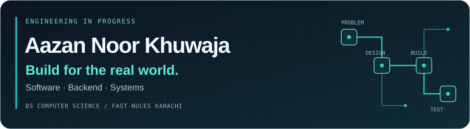
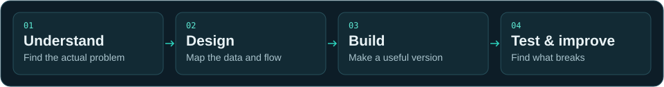

<!-- Aazan Noor Khuwaja | Profile README -->

## About me

I'm a CS student at FAST-NUCES, Karachi. I like working on problems where software has a practical use, whether that's running a pharmacy counter offline or understanding how network requests move between servers.

Building Pharma-Khaato taught me to think beyond the interface: what happens if a checkout fails halfway through, how to keep inventory consistent, and how to make a system usable by the person who actually needs it.

Right now I'm strengthening my backend and systems fundamentals. My longer-term goal is forward deployed engineering — understanding a problem, working with the people who face it, and building software that fits their needs.

## Currently building

**[Pharma-Khaato](https://github.com/aazannoorkhuwaja/Pharma-Khaato)** · Python, PySide6, SQLite

An offline pharmacy POS for Windows and Linux. It handles checkout, expiry-aware stock allocation, customer dues and cash shifts. I am working on the gap between a functioning application and one that is ready for daily use at a pharmacy.

- **Available:** documented v2.5.1 installers, transactional checkout and batch-level inventory.
- **Next:** physical hardware and pharmacy-site acceptance; not yet validated for live pharmacy use.

[Release](https://github.com/aazannoorkhuwaja/Pharma-Khaato/releases/tag/v2.5.1) · [Checkout preview](https://github.com/aazannoorkhuwaja/Pharma-Khaato/blob/main/docs/images/windows-practice-checkout.png) · [Architecture](https://github.com/aazannoorkhuwaja/Pharma-Khaato/blob/main/docs/ARCHITECTURE.md) · [Acceptance checklist](https://github.com/aazannoorkhuwaja/Pharma-Khaato/blob/main/docs/PHARMACY_SITE_ACCEPTANCE.md)

**[Software Load Balancer](https://github.com/RED-Mushaf-Ali-Mir/Software-Load-Balancer-With-Health-Checks)** · Python asyncio, HTTP

A Computer Networks team project for distributing HTTP traffic across multiple servers. The proxy supports round robin, least connections and IP hash. My assigned work is backend test servers and benchmarking, including comparison with HAProxy. Active health checks and benchmarks are still in progress.

[Team repository](https://github.com/RED-Mushaf-Ali-Mir/Software-Load-Balancer-With-Health-Checks#readme)

## Selected work

| Project | What I worked on |
| :--- | :--- |
| **[FlashYT](https://github.com/aazannoorkhuwaja/FlashYT)** | Browser extension and a local Python companion app for video format selection, downloads and progress tracking. [Demo](https://github.com/aazannoorkhuwaja/FlashYT/blob/main/docs/images/flashyt_demo.gif) |
| **[Network Intrusion Detection](https://github.com/aazannoorkhuwaja/Network-Intrusion-Detection)** | Exploratory analysis, a rule-based baseline and supervised classification. Our course benchmark reports **95.58% test accuracy** and **0.9563 F1** for KNN. Original dataset not included. [Results](https://github.com/aazannoorkhuwaja/Network-Intrusion-Detection#benchmark-results-summary) |
| **[FYP Management System](https://github.com/aazannoorkhuwaja/FYP-Management-System-SDA-Project)** | Java Swing team project covering proposals, supervision and peer reviews, using MVC and role-based workflows. [Source](https://github.com/aazannoorkhuwaja/FYP-Management-System-SDA-Project) |

## My toolkit

**Building with**

PySide6, SQL, Bash, Jupyter and browser extension development.

**Learning next**

I'm learning these through projects, alongside HTTP, APIs, database design, [data structures](https://github.com/aazannoorkhuwaja/Data-Structures) and [operating systems](https://github.com/aazannoorkhuwaja/OS-learning).

## Beyond the keyboard

I'm the Vice President of the GitHub Campus Club at FAST-NUCES Karachi. I want to make Git, open source and collaborative development less intimidating for students who are just getting started.

## GitHub activity

<a href="https://github.com/aazannoorkhuwaja?tab=overview">Native GitHub contribution history</a> · <a href="https://github.com/aazannoorkhuwaja?tab=repositories">All repositories</a> · <a href="https://leetcode.com/u/aazannoorkhuwaja">LeetCode</a>

### Recent engineering updates

A few changes from my public project repositories (November 2026):

| Date | Repository update |
| :--- | :--- |
| Nov 23 | [Pharma-Khaato: reorganized documentation and v2.5.1 downloads](https://github.com/aazannoorkhuwaja/Pharma-Khaato/commit/b31733137b9cb6c7e10abef5c285010e43437cb9) |
| Nov 19 | [Pharma-Khaato: documented upgrade paths and practice checkout](https://github.com/aazannoorkhuwaja/Pharma-Khaato/commit/4a21290ac0c344ee7bb29cd403bb4f9d5fa0d183) |
| Nov 17 | [FlashYT: improved project overview and demo links](https://github.com/aazannoorkhuwaja/FlashYT/commit/7be979b909a6eb9fb1f0484662b7e9c1dad1465b) |
| Nov 17 | [Network Intrusion Detection: clarified benchmark evidence and dataset requirements](https://github.com/aazannoorkhuwaja/Network-Intrusion-Detection/commit/986a486c5346cca4511270a3611df17b7ae83e95) |

## Get in touch

I'm open to software engineering internships, research collaborations and projects where I can learn by solving real problems.

[Email](mailto:aazannoorkhuwaja@gmail.com) · [LinkedIn](https://www.linkedin.com/in/aazan-noor-khuwaja-70953927b/) · [Portfolio](https://aazannoorkhuwaja.github.io) · [Resume](./Aazan_noor_cv.pdf)

---

Understand the problem. Build something useful. Keep improving.

