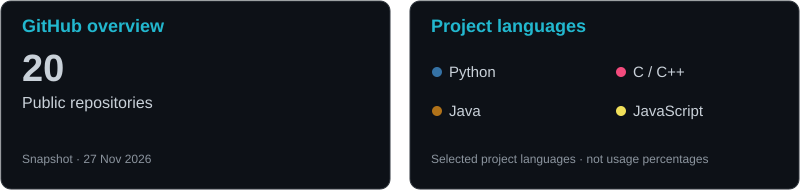

<!-- Profile README — Aazan Noor Khuwaja -->

# Aazan Noor Khuwaja

## About me

I'm a BS Computer Science student at FAST-NUCES Karachi (2028). I build practical software, from an offline pharmacy POS to browser tools and network applications, while developing my backend and systems engineering skills.

**Vice President, GitHub Campus Club** · Open to software engineering internships and research opportunities.

## Currently building

**[Pharma-Khaato](https://github.com/aazannoorkhuwaja/Pharma-Khaato)** · Python, PySide6, SQLite  
Built an offline pharmacy POS with transactional billing and expiry-aware inventory. **v2.5.1 packages for Windows and Ubuntu** are documented; real pharmacy validation is pending. [Release](https://github.com/aazannoorkhuwaja/Pharma-Khaato/releases/tag/v2.5.1) · [Preview](https://github.com/aazannoorkhuwaja/Pharma-Khaato/blob/main/docs/images/windows-practice-checkout.png)

**[Software Load Balancer](https://github.com/RED-Mushaf-Ali-Mir/Software-Load-Balancer-With-Health-Checks)** · Python asyncio, HTTP  
Team-built HTTP reverse proxy supporting **3 traffic distribution algorithms**. My assigned work: backend test servers and HAProxy benchmarking; active health checks and benchmarks pending.

## Selected projects

**[Network Intrusion Detection](https://github.com/aazannoorkhuwaja/Network-Intrusion-Detection)** · Python, scikit-learn  
Achieved **95.58% test accuracy and 0.9563 F1** with KNN in a team course project using 6,000 connection records. My work covered data analysis, rule-based detection and supervised models. Original dataset unavailable in repo.

**[FlashYT](https://github.com/aazannoorkhuwaja/FlashYT)** · JavaScript, Python  
Integrated a browser extension with a local Python download host, with documented support for **Chrome, Edge and Brave**. [Demo](https://github.com/aazannoorkhuwaja/FlashYT/blob/main/docs/images/flashyt_demo.gif)

**[FYP Management System](https://github.com/aazannoorkhuwaja/FYP-Management-System-SDA-Project)** · Java, Swing, MVC  
Team-built MVC application with **3 role-based dashboards** for students, supervisors and administrators, supporting proposals and peer reviews.

## Skills & learning

**Also:** SQL, PySide6, Bash, Jupyter.  
**Learning:** Backend APIs, web development, Docker and [DSA](https://github.com/aazannoorkhuwaja/Data-Structures).

## GitHub activity

  

  

  

  <a href="https://github.com/aazannoorkhuwaja?tab=overview">Contribution history</a> ·
  <a href="https://github.com/aazannoorkhuwaja?tab=repositories">All repositories</a> ·
  <a href="https://leetcode.com/u/aazannoorkhuwaja">LeetCode</a>

